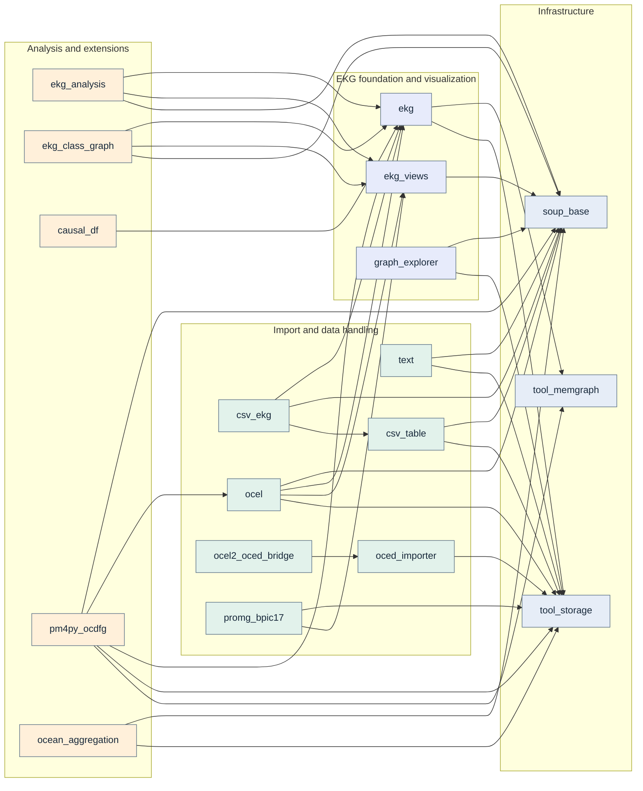

# Packages

Packages are the primary extension mechanism for SOUP. A package can introduce functionality while using services and context exposed by the core application.

## Documenting a package

Each package page should answer four questions:

1. What problem does it solve?
2. Which SOUP version and graph backends does it support?
3. How does a user access it?
4. What limitations or requirements apply?

Add more rows as you confirm the installed package inventory.

## Packages overview

